<div align="center">

# lazyssh

**A keyboard-driven TUI for managing SSH connections.**

Browse, add, edit, connect, tunnel and transfer files — without typing `ssh`, `scp` or `ssh-keygen` again.

[](https://go.dev/dl/)
[](LICENSE)
[](#installation)

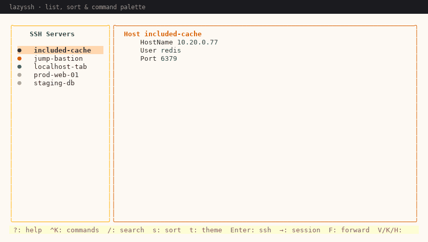

</div>

---

## Why

`~/.ssh/config` is a great format and a terrible interface. lazyssh reads it, writes it back
without losing a single directive, and puts everything you actually do with it — connect,
tunnel, copy files, rotate keys, clean `known_hosts` — behind one screen and a few keys.

It is a thin front-end, not a replacement: sessions are real `ssh` processes in a real PTY,
tunnels are real `ssh -N` processes, so `ProxyJump`, `IdentityFile`, agent forwarding and
everything else in your config keep working.

---

## Highlights

| | |
| --- | --- |
| **Server list** | Live ping dots, pin/star badges, active-session and forwarding markers, four sort orders, inline details pane with scrollable raw config. |
| **Search** | Fuzzy match over alias / host / user, plus `#tag` filters — `web #prod #db` is AND, not OR. |
| **Embedded terminal** | Real PTY sessions in a side panel (`→`) or a full-screen tab strip (`o`) — several at once, `Ctrl+N` / `Ctrl+P` to switch. Scrollable history (wheel / `PgUp`) and clipboard paste (`Ctrl+V` / right-click). |
| **Port forwarding** | Starts `ssh -N` with the host's own `LocalForward` / `RemoteForward` / `DynamicForward` rules; live PID + uptime + state. |
| **SFTP browser** | Dual-pane local⇄remote: upload, download, mkdir, rename, delete. |
| **Keys & known_hosts** | List keys with type / bits / passphrase / agent state, generate, `ssh-add`, `ssh-copy-id`; inspect and prune `known_hosts`. |
| **Command palette** | `Ctrl+K`, type what you want, Enter. Every action is there so you never have to memorise a key. |
| **Safe writes** | Atomic temp-file + rename, timestamped backups, and a **read-only mode** when the config uses `Match` blocks it cannot round-trip. |
| **Themes** | Light and dark, toggled at runtime with `t`. |
| **CLI** | `lazyssh <alias>`, `list`, `check`, `doctor`, `--config`, `--version`. |

---

## Screens

<table>
<tr>
<td width="50%">

**Server list & details**

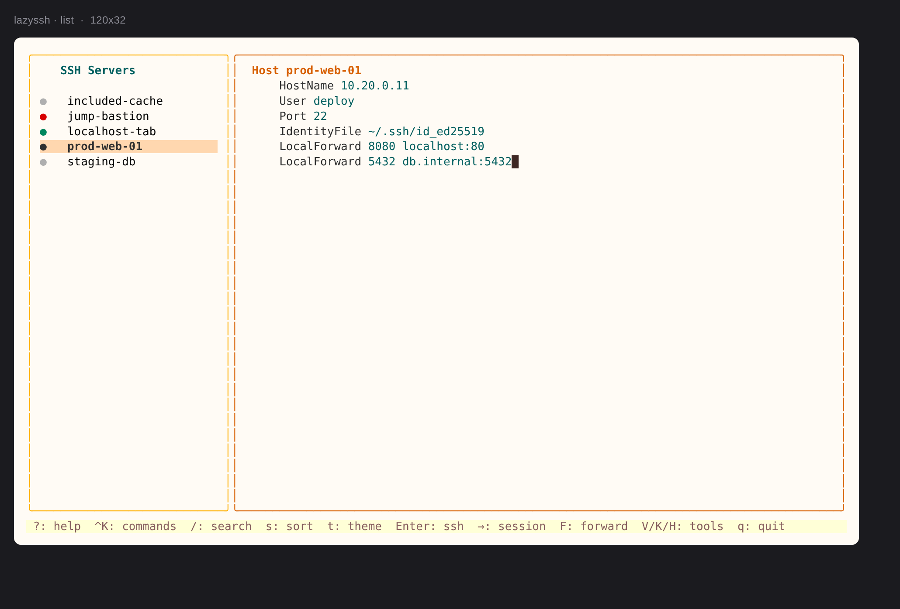

</td>
<td width="50%">

**Command palette** — `Ctrl+K`

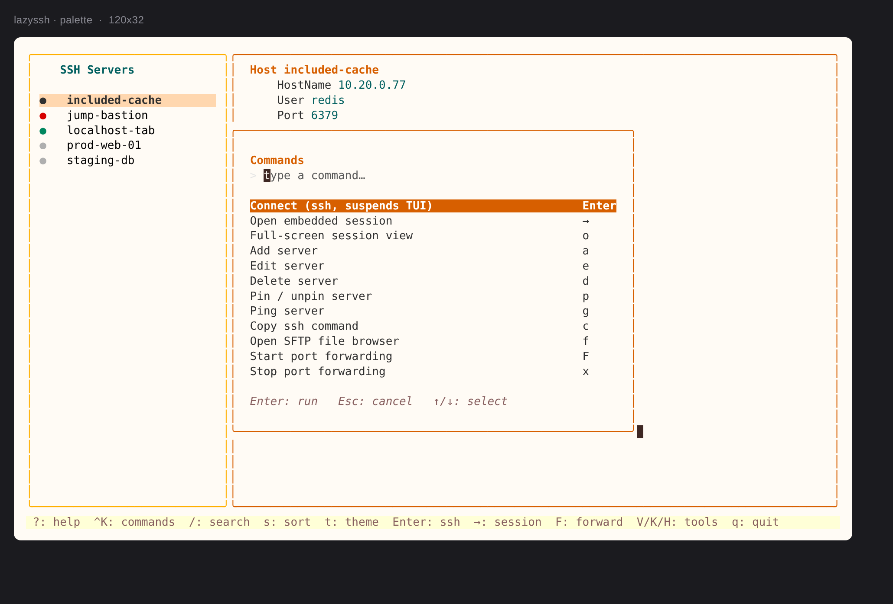

</td>
</tr>
<tr>
<td width="50%">

**Port forwarding manager** — `V`

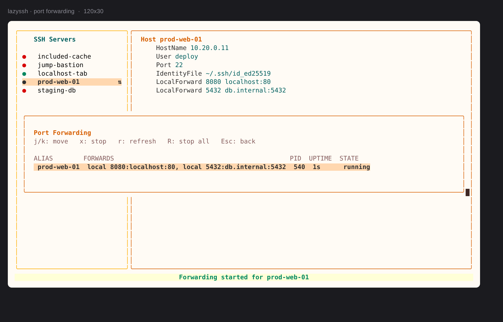

</td>
<td width="50%">

**SSH keys** — `K`

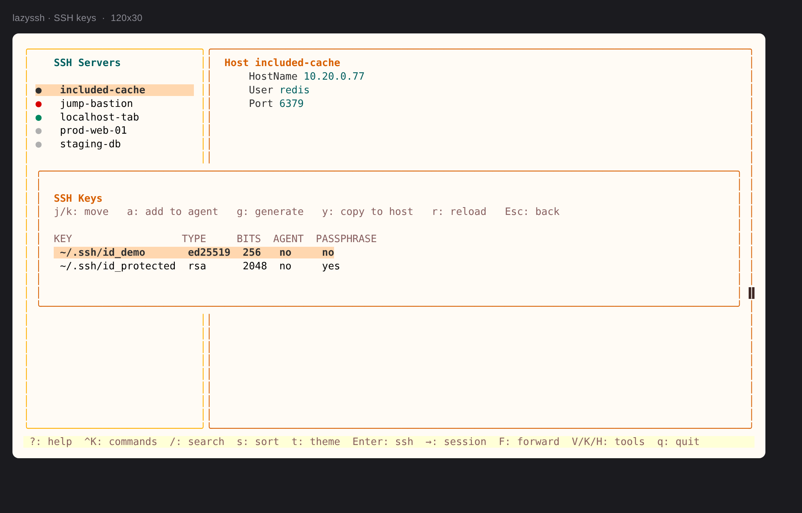

</td>
</tr>
<tr>
<td width="50%">

**known_hosts** — `H`

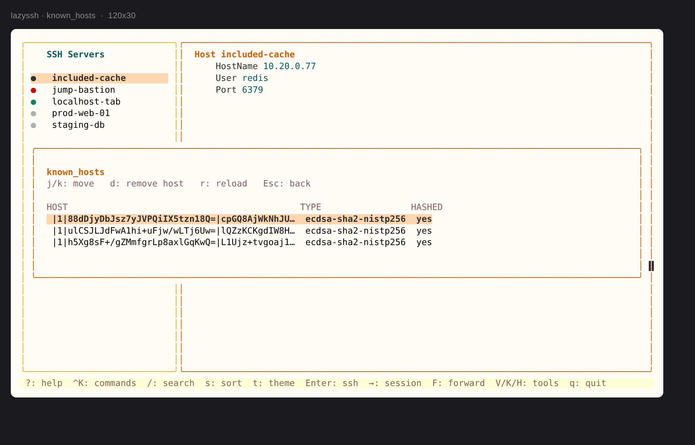

</td>
<td width="50%">

**SFTP browser** — `f`

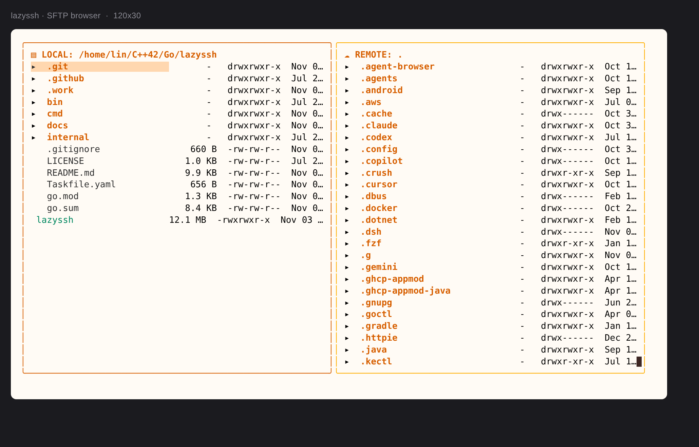

</td>
</tr>
<tr>
<td width="50%">

**Help overlay** — `?`

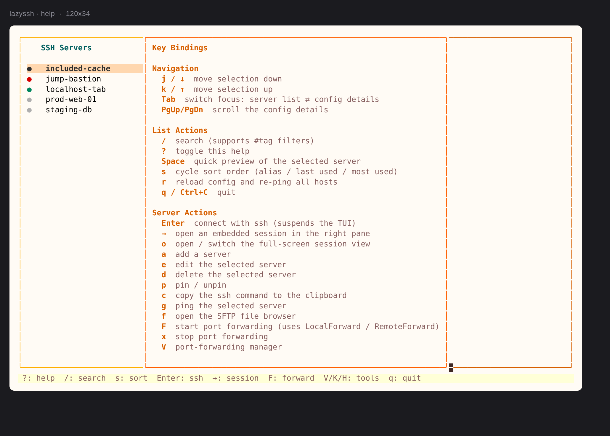

</td>
<td width="50%">

**Dark theme** — `t`

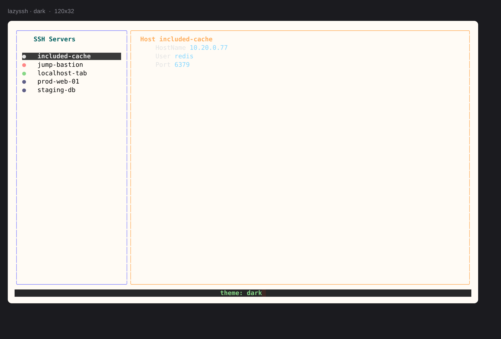

</td>
</tr>
</table>

### Embedded sessions

Press `→` to open a real PTY next to the list, or `o` to promote it to a full-screen tab
strip. Go back with `Ctrl+\` and the session keeps running.


### Terminal history and paste

Each session keeps 5,000 lines of history. The wheel (or `PgUp`/`PgDn`) scrolls back
and the status bar shows how far; typing snaps back to the live output, and `Esc`
does the same without leaving the view.

When the remote program owns the screen (vim, less, htop), the wheel is forwarded to
it instead of scrolling local history, and `Ctrl+V` stays a real `Ctrl+V`.

Paste works three ways: the terminal's own paste shortcut (bracketed paste),
`Ctrl+V`, and right-click — which is what makes password and OTP prompts usable
without retyping.

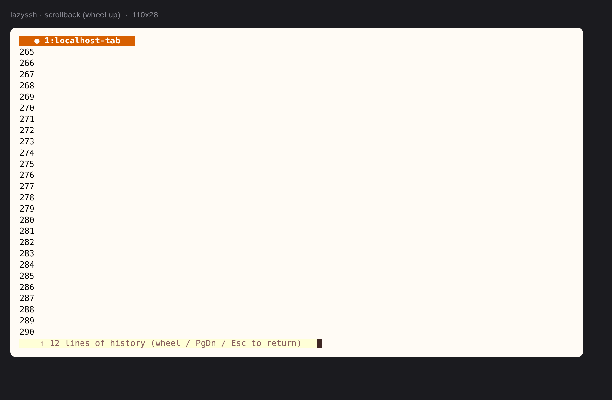

### Port forwarding

`F` starts an `ssh -N` using the host's own forward rules. `V` shows PID, uptime and state,
and stops one (`x`) or all (`R`) of them.

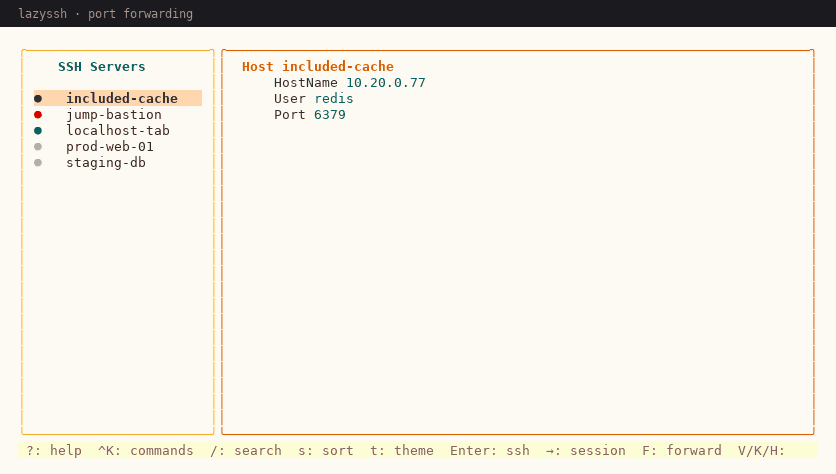

---

## Installation

### Prebuilt binary

Grab the latest release from the [Releases](https://github.com/linpr/lazyssh/releases) page.
Binaries are static and need no runtime dependencies.

**Linux (amd64)**

```sh
curl -L https://github.com/linpr/lazyssh/releases/latest/download/lazyssh-linux-amd64 -o lazyssh
chmod +x lazyssh
sudo mv lazyssh /usr/local/bin/
```

**Windows (amd64)**

Download [`lazyssh-windows-amd64.exe`](https://github.com/linpr/lazyssh/releases/latest/download/lazyssh-windows-amd64.exe),
rename it to `lazyssh.exe`, and put it somewhere on your `%PATH%`.
Verify the download against `checksums.txt`:

```powershell
Get-FileHash .\lazyssh.exe -Algorithm SHA256
```

### From source

Requires **Go 1.26+**.

```sh
git clone https://github.com/linpr/lazyssh.git
cd lazyssh
go build -o lazyssh ./cmd/
./lazyssh
```

Or with [Task](https://taskfile.dev):

```sh
task build   # ./lazyssh
task test
task lint
```

### go install

```sh
go install github.com/linpr/lazyssh/cmd@latest
```

---

## Usage

```sh
lazyssh                     # launch the TUI
lazyssh <alias>             # exec ssh <alias> directly, no TUI
lazyssh list                # alias<TAB>host<TAB>port<TAB>user
lazyssh check               # validate ~/.ssh/config; exit 1 on problems
lazyssh doctor              # environment diagnostics
lazyssh --config <path>     # operate on an alternate ssh config
lazyssh --version           # version and commit
```

`check` is CI-friendly: it exits non-zero when the config cannot be parsed safely, so you can
guard an Ansible/Dotfiles run with it.

---

## Keyboard reference

### Server list

| Key | Action |
| --- | --- |
| `j` `k` / `↑` `↓` | Move selection |
| `Tab` | Switch focus: list ⇄ config details |
| `PgUp` `PgDn` | Scroll the details pane (when focused) |
| `Enter` | Connect with `ssh` (suspends the TUI) |
| `→` | Open an embedded PTY session |
| `o` | Open / switch the full-screen session view |
| `a` `e` `d` | Add / edit / delete server |
| `p` | Pin or unpin |
| `g` | Ping (TCP connect to the SSH port) |
| `c` | Copy the `ssh` command |
| `f` | SFTP file browser |
| `F` `x` | Start / stop port forwarding |
| `V` `K` `H` | Forwards / keys / known_hosts panels |
| `/` | Search — terms and `#tags` |
| `s` | Cycle sort: alias ↑ / alias ↓ / last used / most used |
| `t` | Toggle light / dark theme |
| `r` | Reload config and re-ping |
| `Ctrl+K` or `:` | Command palette |
| `?` | Help overlay |
| `q` | Quit |

### Embedded session

| Key | Action |
| --- | --- |
| `→` | Focus the terminal |
| `Esc` | Back to the list (session keeps running) |
| `Ctrl+N` / `Ctrl+P` | Next / previous session |
| `Ctrl+D` | Close the session for the selected host |
| Wheel / `PgUp` / `PgDn` | Scroll terminal history |
| `Ctrl+V` / right-click | Paste the clipboard into the session |

### Full-screen sessions

| Key | Action |
| --- | --- |
| `Ctrl+N` / `Ctrl+P` | Next / previous tab |
| `Ctrl+W` | Close the active tab |
| `Ctrl+\` | Back to the list (sessions keep running) |
| Wheel / `PgUp` / `PgDn` | Scroll terminal history |
| `Esc` | Jump back to the live output |
| `Ctrl+V` / right-click | Paste the clipboard into the session |

### Panels

| Panel | Keys |
| --- | --- |
| Forwarding (`V`) | `j`/`k` move · `x` stop · `R` stop all · `r` refresh · `Esc` back |
| Keys (`K`) | `j`/`k` move · `a` add to agent · `g` generate · `y` copy to host · `r` reload |
| known_hosts (`H`) | `j`/`k` move · `d` remove host · `r` reload |

### SFTP browser (`f`)

| Key | Action |
| --- | --- |
| `Tab` | Switch pane (local ⇄ remote) |
| `Enter` | Enter directory |
| `h` / `Backspace` | Up one directory |
| `u` / `d` | Upload / download |
| `n` `r` `x` | mkdir / rename / delete |
| `R` | Reload pane |
| `q` / `Esc` | Close |

### Form editor

`Tab` / `Shift+Tab` switch tabs, `↑` / `↓` move between fields, `Enter` previews the exact
config block that will be written, `Esc` cancels.

---

## How it stays safe

lazyssh edits a file you cannot afford to lose, so every write is conservative:

- **Nothing is dropped.** The edit form exposes ~30 fields; everything else in the host block
  (`RemoteCommand`, `RequestTTY`, `SendEnv`, `ProxyCommand`, …) is preserved verbatim,
  because the form starts from the block on disk and only overwrites the fields it owns.
- **Atomic replace.** The new config is written to a temp file in the same directory,
  `fsync`ed, then `rename`d over the original. A crash or a second instance cannot leave a
  half-written config. The same applies to `~/.lazyssh/metadata.json`.
- **Backups.** `config.original.backup` is created before the first write; every later write
  keeps up to 10 timestamped copies.
- **Read-only fallback.** If the file contains `Match` blocks the parser would rewrite
  lossily (`Match user`, `Match exec`, `Match final`, …), lazyssh refuses to edit and tells
  you why. `lazyssh check` reports it too.
- **No shell interpolation.** The `SSH_ASKPASS` helper reads the password from an environment
  variable instead of embedding it in a script, so a password like `a$(id)b` is a password,
  not a command.

---

## Configuration

| Path | Purpose |
| --- | --- |
| `~/.ssh/config` | Source of truth. `Include` directives are followed (up to 8 levels deep, with cycle detection), so hosts from `config.d/*` appear in the list. |
| `~/.lazyssh/metadata.json` | Pin state, tags, last seen, connection count. Written atomically. |
| `~/.lazyssh/lazyssh.log` | Debug log (falls back to a temp directory when `$HOME` is read-only). |

There is no separate settings file — the SSH config *is* the settings.

---

## Architecture

```
cmd/                         CLI entry, subcommands, flag parsing
internal/adapters/ui/        Bubble Tea models: list, form, details, panels, palette, theme
internal/adapters/data/      ssh_config reader/writer (Include expansion, atomic writes)
internal/core/domain/        Plain structs: Server, ForwardRule, SSHKey, KnownHostEntry
internal/core/ports/         Interfaces the UI depends on
internal/core/services/      ssh/ssh-keygen/sftp orchestration, ping cache, forwarding
internal/logger/             zap wrapper with best-effort fallbacks
```

The UI depends on `ports.ServerService`, not on the repository — which is what makes the
`internal/adapters/ui` tests runnable with a stub service.

---

## Development

```sh
go test ./...                # unit tests (adapters + services)
go vet ./...
gofmt -l cmd internal        # should print nothing
GOOS=windows go build ./cmd/ # cross-compile check
```

The test suite covers the things that used to break silently: include expansion, field
preservation on edit, `#tag` queries, atomic metadata writes, askpass isolation, forwarding
argv, control-socket path safety, ping caching, sort orders, layout sizing, overlay widths,
remote path joining, theme switching and palette filtering.

---

## Release

Pushing a `v*` tag runs [`.github/workflows/release.yml`](.github/workflows/release.yml):

```sh
git tag v2.0.0
git push origin v2.0.0
```

The workflow has three jobs:

1. **test** — `gofmt` gate, `go vet`, `go test ./...`, plus a Windows cross-compile check,
   so a broken tag never reaches a release.
2. **build** — matrix over `linux/amd64` and `windows/amd64`, `CGO_ENABLED=0` with
   `-trimpath` and version/commit stamped via `-ldflags`. The Linux binary is smoke-tested
   (`--version`, `--help`) before it is uploaded.
3. **release** — downloads both artifacts, restores the executable bit (zip artifacts drop
   it), writes `checksums.txt`, and publishes the GitHub Release.

Tags containing a hyphen (`v2.1.0-rc1`) are published as pre-releases. The first run needs
no secrets beyond the default `GITHUB_TOKEN`, which the workflow narrows to `contents: write`
for the release job only.

---

## License

[Apache License 2.0](LICENSE)
